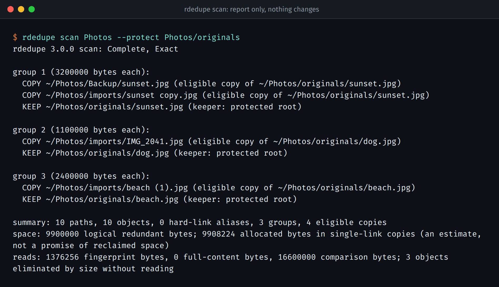
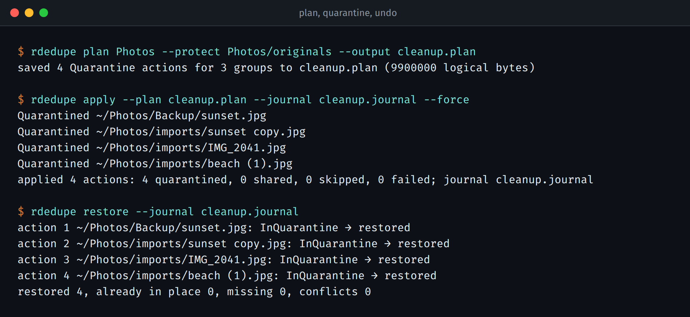

<p align="center">
  
</p>

# rdedupe

rdedupe finds duplicate files and helps you clean them up without losing anything.

Point it at a folder and it tells you which files are exact copies of each other, which
copy it would keep, and how much space the others take. It changes nothing until you
ask it to. When you do, the copies go into a quarantine folder next to where they were,
so you can put every one of them back with a single command.

<p align="center">
  
</p>

## Why trust it with your files

"Duplicate" here means the same bytes, all of them. rdedupe uses quick fingerprints to
rule files out, but it never reports two files as duplicates until it has compared them
byte by byte. A file with a size nobody else has is never even opened.

If something gets in the way, you hear about it. A file it couldn't read, or one that
changed while it was reading, is listed as unresolved, the scan is marked partial (exit
code 2), and rdedupe refuses to build a cleanup plan from that scan.

Cleanup always goes through a saved plan:

1. `rdedupe plan` writes down exactly what it would do.
2. `rdedupe apply` checks every file again right before touching it, writes a journal
   entry to disk first, and only then moves the copy.
3. `rdedupe restore` puts everything back, and `rdedupe purge` deletes the quarantined
   copies for good (and only if the original is still there and still identical).

Plans and journals are signed with a key only you have, so a plan someone edited is
refused. If the machine crashes halfway through, `rdedupe recover` tells you where every
file is, and `apply --resume` finishes the job.

It also stays small. It keeps its working list in a small on-disk database instead of
memory and never loads a whole file. A scan of a 4,000-file group plus two 256 MiB files
peaked at about 10.7 MiB of memory with a 16 MiB budget
([measurements](docs/benchmarks.md)).

## Quick start

```console
rdedupe scan ~/Pictures                                    # report only
rdedupe scan ~/Pictures --protect ~/Pictures/originals     # never pick copies from there
```

Each group shows one `KEEP` and its `COPY` lines, with the reason for each choice. You
decide which copy survives:

- `--protect DIR`: files under DIR are never touched.
- `--prefer DIR`: keep the copy under DIR when there is one.
- `--prefer-newest`: keep the most recently modified copy.
- Otherwise the copy whose path sorts first wins, so the same files always give the
  same answer.

When the report looks right, clean up:

<p align="center">
  
</p>

```console
rdedupe plan ~/Pictures --protect ~/Pictures/originals --output cleanup.plan
rdedupe apply --plan cleanup.plan --journal cleanup.journal    # move copies to quarantine
rdedupe restore --journal cleanup.journal                      # changed your mind? undo
rdedupe purge --journal cleanup.journal                        # or free the space for real
```

Keep the plan and journal files outside the folder you are cleaning. `apply` and `purge`
ask before they act; `--force` skips the question for scripts.

Quarantine alone frees no space, because the copies are only moved. Space comes back
when you `purge`. On Btrfs or XFS there is a third option: `rdedupe plan --action extent`
keeps every file where it is and asks the filesystem to store identical files once. If
the filesystem can't, the action fails and nothing else is tried.

## Install

Download the archive for your platform from the
[releases page](https://github.com/blackopsrepl/rdedupe/releases), check it against its
`.sha256` file, and put the `rdedupe` binary on your `PATH`. The Linux archive is a static
binary with no dependencies. Or build it with Rust 1.85 or newer:

```console
cargo install --locked --git https://github.com/blackopsrepl/rdedupe
```

Linux supports everything. macOS supports everything except extent sharing. Other Unix
systems can scan, report and plan, but cannot quarantine, because they lack a safe way to
move directories without overwriting. To see what a given disk supports, run
`rdedupe capabilities --path DIR`.

## Scripts and agents

`--format jsonl` prints versioned records with every path encoded losslessly, so even
file names with newlines or invalid UTF-8 survive. `--format csv` does the same in CSV,
and `--format nul` lists the copies a plan would act on, for `xargs -0`. Exit codes are
stable: 0 complete, 2 partial, 3 declined, 4 error, 64 bad arguments, 130 interrupted,
141 broken pipe. The details are in [docs/cli.md](docs/cli.md) and
[docs/formats.md](docs/formats.md).

Coding agents can run rdedupe on their own with the skill in
[`skills/rdedupe`](skills/rdedupe/SKILL.md). It ships in every release archive next to
the matching binary. It covers what an agent may do without asking, the exact commands,
when to stop, and how to recover. We tested it with Claude Code on real fixtures;
[docs/agent-operation.md](docs/agent-operation.md) shows how to install it and what
happened in those runs.

## Coming from 2.x

3.0 is a rewrite. The old `--delete` flag no longer deletes anything: it refuses and
points you to `plan` and `apply`, which quarantine instead. The CSV columns changed, and
the Polars/DataFrame library API is gone.
[docs/migration.md](docs/migration.md) maps each old command to its new form.

## More reading

- [Safety](docs/safety.md): what rdedupe checks, and what nobody can promise on a folder
  that other programs are writing to.
- [Design](docs/design.md): how the scan works and why it stays within its budget.
- [Benchmarks](docs/benchmarks.md) and [tests](tests/README.md).

## Development

```console
make            # list every target
make check      # formatting, clippy and the full test suite
make dist       # build and verify a release archive
```

`make screenshots` regenerates the images above from real runs of the release binary.

## License

[CC0-1.0](LICENSE), including the agent skill. Noah Gift created the original
`noahgift/rdedupe`. Vittorio Distefano maintains this rewrite. The mascot is a hermit crab
that carries its quarantine crate on its back.
